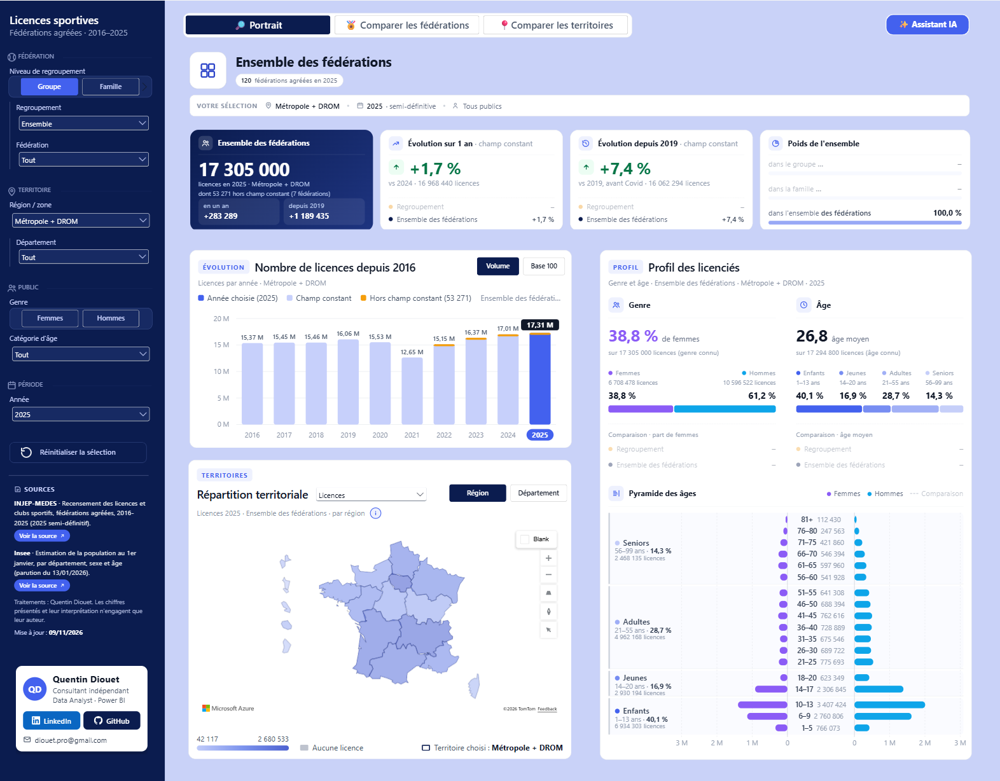
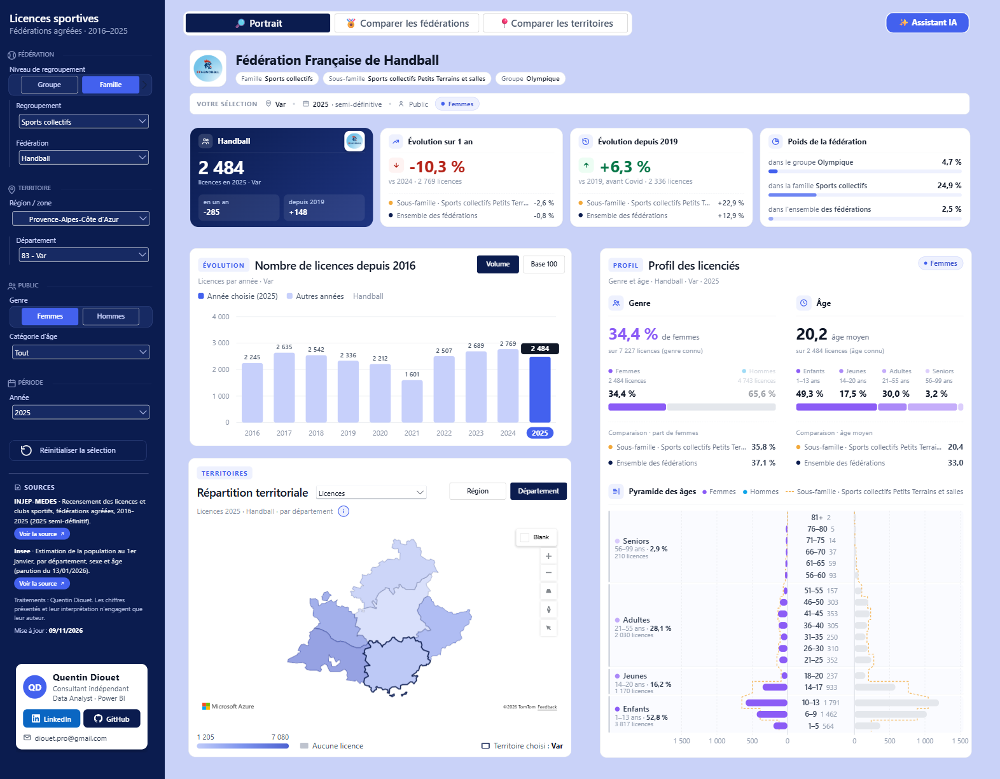
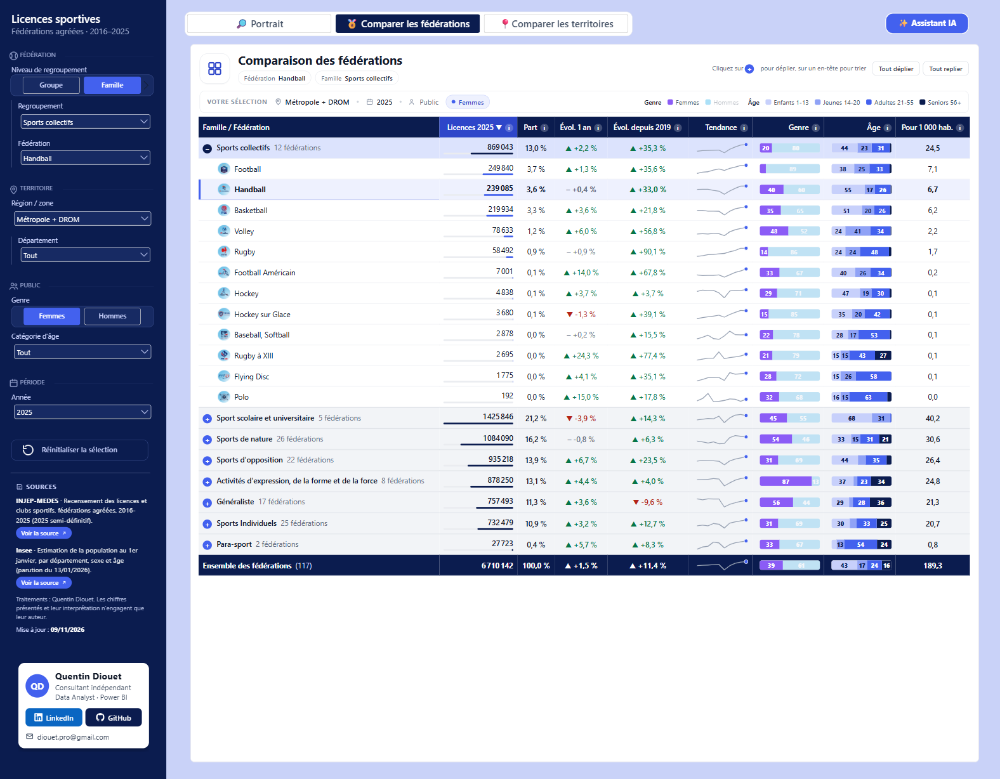
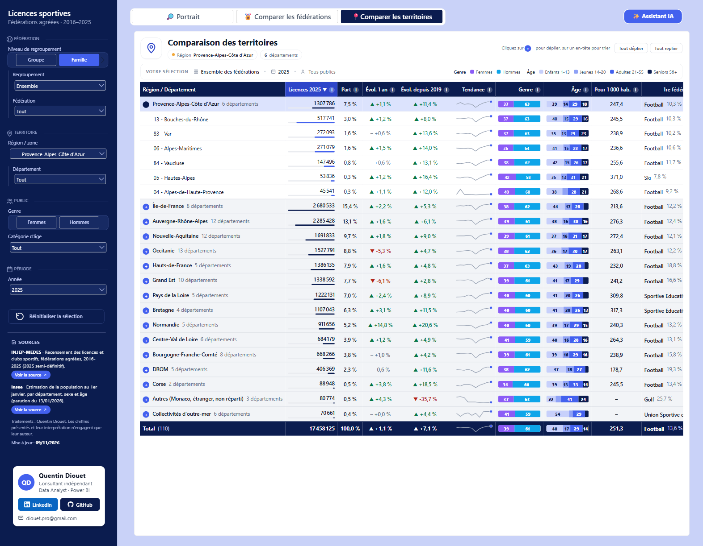
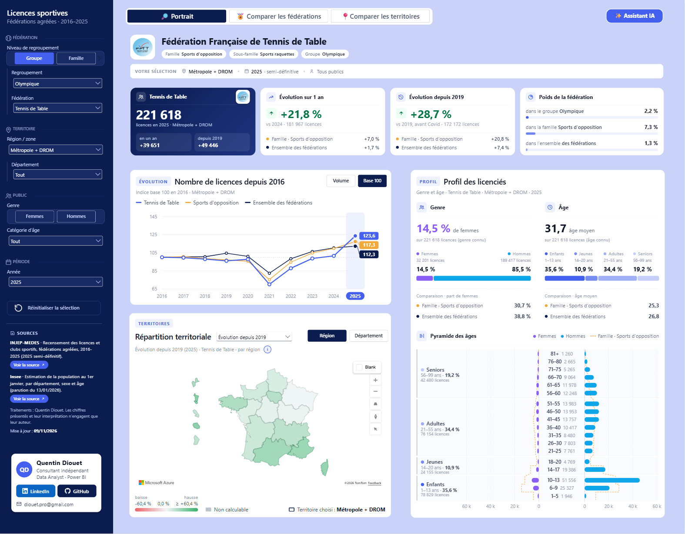
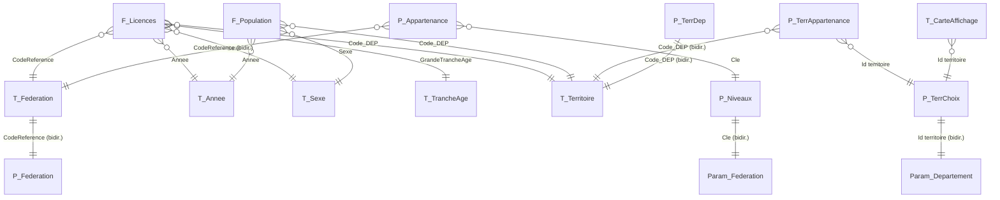

# 🏅 Licences sportives en France : rapport Power BI

> Tableau de bord interactif sur les **licences des fédérations sportives agréées** en France entre **2016 et 2025** : jusqu'à 117 fédérations par an, environ 17,5 millions de licences par an, détail par sexe, âge et département.
> Données publiques **INJEP-MEDES** (recensement des licences) et **Insee** (population).
> Projet conçu et réalisé de bout en bout par **Quentin Diouet**, consultant Data Analyst · Power BI.

[](#)
[](sql/)
[](docs/03_Catalogue_mesures.md)
[](powerquery/)
[](src/html/)
[](LICENSE)

<p align="center">
  <a href="https://app.powerbi.com/view?r=eyJrIjoiZGIwYjIyYzAtMjg0Ni00MDQxLTljOTgtN2RhMDBjM2U3NjJiIiwidCI6ImIwMDI3NmM5LTJiNmYtNDVmYS1iYzYxLTA3YTAyY2JmNjQ2ZSJ9"></a>
</p>



---

## Sommaire

1. [En bref](#1-en-bref)
2. [Le rapport](#2-le-rapport)
3. [Compétences mises en œuvre](#3-compétences-mises-en-œuvre)
4. [Architecture des données](#4-architecture-des-données)
5. [Modèle sémantique](#5-modèle-sémantique)
6. [Choix de conception marquants](#6-choix-de-conception-marquants)
7. [Organisation du dépôt](#7-organisation-du-dépôt)
8. [Installer et actualiser](#8-installer-et-actualiser)
9. [Sources et mises en garde](#9-sources-et-mises-en-garde)
10. [Documentation détaillée](#10-documentation-détaillée)
11. [Auteur](#11-auteur)

---

## 1. En bref

| | |
|---|---|
| **Question métier** | Qui pratique quel sport, où, et comment cela évolue-t-il depuis 2016 (et depuis la crise sanitaire) ? |
| **Périmètre** | jusqu'à 117 fédérations agréées par an · 2016 → 2025 · 110 territoires (101 départements, 6 COM, Monaco, étranger, non-répartis) · sexe · âge exact |
| **Volume** | 8,2 millions de lignes de faits (10 fichiers CSV, environ 1,4 Go) chargées dans SQL Server |
| **Chaîne** | CSV INJEP → **SQL Server** (chargement, typage, contrôles) → référentiel **Excel** synchronisé → **Power Query** → modèle en étoile **DAX** → visuels natifs, **Azure Maps** et **HTML/JS** |
| **Format** | Projet **PBIP** (rapport PBIR et modèle TMDL), versionné sous Git |
| **Utilisateurs visés** | Mouvement sportif, collectivités, services de l'État, journalistes, grand public |

**Chiffres de contrôle** (millésime 2025, vérifiés dans le modèle) : 17 456 435 licences en 2025, contre 16 259 965 en 2019 et 12 841 261 en 2021 (creux Covid).

---

## 2. Le rapport

Trois pages au format 1960 × 1530. Un **panneau de gauche** commun porte les segments, les sources, la date de mise à jour et la carte auteur.

| Page | Objectif | Contenu |
|---|---|---|
| 🔎 **Portrait** | Tout savoir d'une fédération, d'un regroupement ou de l'ensemble, sur un territoire | En-tête dynamique (logo, nom, famille), 4 chiffres clés (licences, évolutions, poids, rang), carte choroplèthe **Azure Maps** (régions ou départements, 6 indicateurs), profil (genre, âges, pyramide), évolution 2016-2025 en volume ou en base 100 avec comparaison au regroupement et à l'ensemble |
| 🏅 **Comparer les fédérations** | Classer et comparer les fédérations | Tableau HTML interactif : tri sur chaque colonne, vue en liste ou par famille / sous-famille / groupe (groupes dépliables), sélection mise en évidence, mini-courbes de tendance, barres genre et âge, taux pour 1 000 habitants, infobulles |
| 📍 **Comparer les territoires** | Comparer les départements ou les régions | Même moteur de tableau, appliqué aux territoires : groupement par région, DROM, COM et autres, total adapté au périmètre (Total, Métropole, Métropole + DROM), indice de spécificité ou 1re fédération du territoire |

| | |
|---|---|
| <br>*Portrait d'une fédération sur un département* | <br>*Assistant intégré (simulateur, sans IA externe)* |
| <br>*Comparer les fédérations* | <br>*Comparer les territoires* |
| <br>*Carte des évolutions depuis 2019* | |

👉 **[Ouvrir le rapport en ligne](https://app.powerbi.com/view?r=eyJrIjoiZGIwYjIyYzAtMjg0Ni00MDQxLTljOTgtN2RhMDBjM2U3NjJiIiwidCI6ImIwMDI3NmM5LTJiNmYtNDVmYS1iYzYxLTA3YTAyY2JmNjQ2ZSJ9)** (publication web, aucune connexion requise).

**Segments** : Année · Public (genre, âge) · Niveau (famille, sous-famille, groupe) → Regroupement → Fédération · Territoire → Département · Indicateur et niveau géographique de la carte.

---

## 3. Compétences mises en œuvre

| Domaine | Ce que montre le projet |
|---|---|
| **Ingénierie de données (SQL Server)** | Chargement en masse de 10 CSV hétérogènes (ordre de colonnes variable selon le millésime), zone tampon, typage, chargement idempotent, journal, index columnstore, vues de dimension, contrôles qualité. Voir [`sql/`](sql/). |
| **Gestion d'un référentiel** | Référentiel Excel **synchronisé avec SQL** par une fonction Power Query générique (`fnSynchro`) : il ajoute les nouvelles valeurs, conserve les enrichissements manuels et marque les valeurs disparues. Voir [`powerquery/referentiel_excel/`](powerquery/referentiel_excel/). |
| **Power Query (M)** | Fonction de lecture commune (`fnLireReferentiel`), repli de requête vers SQL, dépivotage et pivot dynamiques pour construire les segments, lecture de l'Insee (10 onglets × 40 colonnes), code commenté. |
| **Modélisation** | Schéma en étoile, tables ponts (fédération ↔ regroupements, territoire ↔ départements), paramètres de champ en cascade, groupe de calcul, tables déconnectées pour l'interface. |
| **DAX avancé** | 114 mesures documentées : gestion fine du contexte de filtre (`ISFILTERED` / `ISCROSSFILTERED`, `TREATAS`, `KEEPFILTERS`), indice de spécificité, taux pour 1 000 habitants avec périmètre de population cohérent, échelle de couleurs « rang + valeur », génération de HTML, SVG et JSON en DAX, encodage base 64 en arithmétique pure. |
| **Data visualisation** | Charte graphique centralisée **dans des mesures** (couleurs, tailles, blocs CSS), visuels HTML sur mesure, carte Azure Maps pilotée par mesures, infobulles riches, accessibilité des libellés. |
| **Développement web** | Moteur JavaScript commun aux deux tableaux (tri, regroupement, SVG, infobulles), données transmises par le DAX sous la limite d'environ 32 000 caractères du visuel. Voir [`src/html/`](src/html/). |
| **Assistant conversationnel** | Simulateur d'IA en JavaScript qui fonctionne en publication web : analyse de la question en langage naturel, calculs alignés sur les mesures (39 valeurs contrôlées contre le DAX), classements, rangs, listes, seuils et critères combinés, mini-graphiques SVG (courbe, carte de France, pyramide) et phrases d'analyse automatiques. Données précalculées et découpées en blocs pour dépasser la limite de 32 767 caractères. Voir [docs/07](docs/07_Assistant.md). |
| **Industrialisation** | Format PBIP / TMDL sous Git, documentation **générée automatiquement** depuis le modèle ([`tools/`](tools/)), descriptions sur toutes les tables, colonnes et mesures, nettoyage des objets inutilisés. |
| **Rigueur statistique** | Respect des mises en garde INJEP (non-répartis, comparabilité dans le temps), choix de 2019 comme année de référence avant Covid, sources et date de mise à jour affichées dans le rapport. |

---

## 4. Architecture des données

```mermaid
flowchart LR
    subgraph Sources publiques
        A[INJEP-MEDES<br/>10 CSV 2016-2025<br/>~1,4 Go]
        B[Insee<br/>estimations de population<br/>départements x sexe x âge]
    end
    subgraph SQL Server « diouet » / BDD
        C[stg.Licences_Brut<br/>zone tampon texte]
        D[(dbo.Licences_Federation<br/>8,2 M lignes, columnstore)]
        E[vw_Dim_Federation<br/>vw_Dim_Territoire<br/>vw_Dim_Sexe · vw_Dim_TrancheAge · vw_Dim_Annee]
        J[dbo.Journal_Chargement]
    end
    subgraph Référentiel Excel
        F[Referentiel_Excel.xlsx<br/>fnSynchro + enrichissements manuels<br/>familles · groupes · logos · zones]
    end
    subgraph Power BI - PBIP
        G[Power Query<br/>F_Licences · F_Population<br/>dimensions via fnLireReferentiel]
        H[Modèle en étoile<br/>27 tables · 17 relations · 114 mesures]
        I[Rapport 3 pages<br/>natif + Azure Maps + HTML/JS]
    end
    A -- BULK INSERT --> C -- typage, contrôles --> D
    D --> E --> F
    D -- Sql.Database --> G
    F -- Excel.Workbook --> G
    B -- Excel.Workbook --> G
    G --> H --> I
    C -. journal .-> J
```

| Étape | Outil | Détails |
|---|---|---|
| 1. Collecte | Archive INJEP `.7z` | Un CSV par année. 2016-2018, 2024 et 2025 sont semi-définitifs, 2019-2023 définitifs |
| 2. Intégration | T-SQL ([`sql/`](sql/)) | `usp_Charger_Millesime_Licences` : BULK INSERT, remise en ordre des colonnes, typage (`NR - Non réparti` → `NULL` pour l'âge), traçabilité (`Fichier`, `Statut`, `MillesimeReference`) |
| 3. Référentiel | Excel + Power Query | Les vues `vw_Dim_*` alimentent les onglets. Les familles, sous-familles, groupes, logos et zones géographiques sont saisis à la main et conservés à chaque synchronisation |
| 4. Préparation | Power Query | Faits en repli de requête vers SQL (colonnes utiles uniquement), clé `Code_DEP`, dimensions par une fonction commune, population Insee dépivotée |
| 5. Modèle | DAX / TMDL | Étoile autour de `F_Licences` et `F_Population`, tables d'interface calculées en DAX |
| 6. Restitution | Power BI | Visuels natifs, Azure Maps, HTML Content (édition standard pour les scripts) |

---

## 5. Modèle sémantique



| Famille | Tables | Rôle |
|---|---|---|
| **Faits** | `F_Licences`, `F_Population` | Licences (grain : fédération × année × sexe × âge × département) et population Insee |
| **Dimensions** | `T_Federation`, `T_Territoire`, `T_Annee`, `T_Sexe`, `T_TrancheAge` | Issues du référentiel Excel |
| **Segments fédération** | `P_Niveaux`, `P_Appartenance`, `P_Federation`, `Param_Niveau`, `Param_Federation` | Cascade Niveau → Regroupement → Fédération, par paramètres de champ |
| **Segments territoire** | `P_TerrChoix`, `P_TerrAppartenance`, `P_TerrDep`, `Param_Departement` | Cascade Territoire → Département, avec le même principe |
| **Carte** | `T_CarteZone`, `T_CarteZoneDep`, `T_CarteAffichage`, `T_CarteIndicateur`, `T_NiveauGeo` | Zones du GeoJSON, zones affichées selon le territoire, indicateur et niveau |
| **Interface** | `Comparaison` (groupe de calcul), `T_AnneeAxe`, `T_VueEvol`, `T_MAJ`, `_Mesures` | Courbes Sélection / Regroupement / Ensemble, axe déconnecté, bascules, date de mise à jour |

Toutes les tables, colonnes et mesures ont une description, visible dans Power BI au survol. Le détail est dans le [dictionnaire de données](docs/02_Dictionnaire_donnees.md) et le [catalogue des mesures](docs/03_Catalogue_mesures.md).

---

## 6. Choix de conception marquants

1. **Segments en cascade par paramètres de champ**. Le segment Fédération change de colonne selon le regroupement choisi (`Param_Federation` → colonnes de `P_Federation`), ce qui affiche uniquement les fédérations du regroupement et vide la sélection quand on change de niveau. Le même schéma est repris pour Territoire → Département.
2. **Clés stables plutôt que libellés** : `CodeReference` (nomenclature 2025) pour les fédérations, `Code_DEP` pour les territoires, `Id territoire` (`TOT`, `MDR`, `MET`, `R84`, `DROM`, `COM`, `AUT`) pour les choix de périmètre.
3. **Charte graphique dans des mesures** (dossier `00. Charte graphique`) : une couleur ou une taille se change à un seul endroit et s'applique à tous les visuels HTML, à la carte et aux tableaux.
4. **Visuels HTML générés en DAX**. En-tête, chiffres clés, profil, évolution et cadre de la carte sont des blocs HTML/SVG produits par des mesures, pour une mise en page impossible avec les visuels natifs.
5. **Tableaux de comparaison « data in DAX + moteur JS »**. La mesure transmet les données compactées (nombres en base 64, préfixes de logos abrégés) et le moteur JavaScript commun fait le rendu. Un seul moteur et une seule feuille de style servent les deux pages, sous la limite d'environ 32 000 caractères.
6. **Carte Azure Maps pilotée par mesures** : zones affichées selon le territoire (`T_CarteAffichage`), couleur calculée en DAX avec une échelle qui mélange rang et valeur (dégradé lisible même avec des valeurs extrêmes, échelle divergente pour les évolutions et l'indice), contour de la sélection.
7. **Population au même périmètre que les licences**. Le taux pour 1 000 habitants n'additionne que les départements présents dans les données Insee (`TREATAS` + `KEEPFILTERS`), ce qui exclut l'étranger et les non-répartis.
8. **2019 comme année de référence**, pour mesurer la reprise après la crise sanitaire indépendamment du creux 2020-2021. **Évolutions à champ constant, comme l'INJEP** : la colonne calculée `T_Federation[Champ constant]` repère les fédérations présentes chaque année de la période (109 sur 2016-2025) ; les évolutions des regroupements, des territoires et du total ne comptent qu'elles (`Licences champ constant`), les volumes comptent toutes les fédérations. Chaque visuel l'indique (« · champ constant », part hors champ en orange dans le graphique Évolution, « dont 53 320 hors champ constant » dans les chiffres clés) pour qu'un lecteur qui refait la somme retrouve le total. Une fédération seule garde sa propre évolution.
9. **Nettoyage et documentation continus** : objets inutilisés supprimés après une analyse des dépendances (rapport, mesures, relations, tri, tables calculées), puis documentation régénérée depuis le TMDL.
10. **Assistant intégré sans IA externe**. Un moteur JavaScript (4 blocs) répond aux questions en langage naturel à partir de données précalculées (`T_Assistant_Bloc` : cube fédération × département, séries fédération × région, licences féminines, tranches d'âge, pyramides), en blocs de moins de 32 767 caractères qui communiquent par le document. Il dessine ses propres graphiques en SVG, rédige une phrase d'analyse et a été contrôlé valeur par valeur contre les mesures DAX. Compatible avec la publication sur le web. Détails : [docs/07_Assistant.md](docs/07_Assistant.md).

Détails et justifications : [docs/01_Conception.md](docs/01_Conception.md).

---

## 7. Organisation du dépôt

```
LicencesFederations/
├── README.md                     ← ce document
├── CHANGELOG.md                  journal des versions
├── LICENSE                       licence MIT (code) · données et logos exclus
├── reports/
│   ├── Licences_Federations.pbip
│   ├── Licences_Federations.Report/         pages et visuels (PBIR, JSON)
│   └── Licences_Federations.SemanticModel/  modèle (TMDL : tables, mesures, relations, Power Query)
├── sql/                          intégration SQL Server (création, chargement, vues, contrôles)
├── powerquery/                   code M de chaque requête (généré) + synchro du référentiel Excel
├── src/html/                     sources lisibles du moteur JS et de la feuille de style des tableaux
│   └── assistant/                moteur (4 parties), styles, textes, build, banc de test et contrôle DAX de l'assistant
├── tools/generer_documentation.py  génère le dictionnaire, le catalogue et powerquery/*.pq
├── docs/                         conception, dictionnaire, catalogue, intégration, maintenance
│   └── images/                   captures du rapport et aperçus de l'assistant
├── media/                        supports de présentation : vidéo, visuels et post LinkedIn
├── assets/
│   ├── logos/                    logos des fédérations (servis par jsDelivr depuis GitHub)
│   ├── icones/                   icônes de l'interface (SVG et PNG)
│   ├── cartes/                   contours régions et départements (GeoJSON)
│   └── theme/                    thème Power BI « Marine »
└── data/                         référentiel Excel, population Insee (CSV INJEP non versionnés)
    └── reference/                fichier INJEP des évolutions à champ constant (contrôle)
```

---

## 8. Installer et actualiser

**Prérequis** : Power BI Desktop (version récente, PBIP et TMDL activés), SQL Server 2019 ou plus récent, le visuel **HTML Content** (édition standard) et Azure Maps activé.

1. **Base de données** : exécuter dans l'ordre `sql/01_creation_structure.sql`, `02_chargement_csv.sql`, `03_vues_dimensions.sql`, puis :
   ```sql
   EXEC dbo.usp_Charger_Millesime_Licences @Dossier = N'C:\...\LicencesFederations\data\2025\';
   ```
   et vérifier avec `sql/04_controles_qualite.sql`.
2. **Référentiel** (facultatif) : dans `data/Referentiel_Excel.xlsx`, faire *Données → Actualiser tout* pour synchroniser les onglets avec les vues SQL, puis compléter les colonnes manuelles des nouvelles lignes.
3. **Power BI** : ouvrir `reports/Licences_Federations.pbip`, régler le paramètre `Dossier` (*Transformer les données → Gérer les paramètres*) et le serveur SQL si besoin, puis cliquer sur **Actualiser**.
4. **Visuel HTML Content** : dans le format du visuel, activer *Autoriser l'ouverture des URL* et *Autoriser la sélection de texte* (blocs Sources et Auteur).
5. **Documentation** : après une modification du modèle, lancer `python tools/generer_documentation.py`.

La procédure complète de mise à jour d'un millésime est dans [docs/05_Maintenance.md](docs/05_Maintenance.md).

---

## 9. Sources et mises en garde

| Source | Contenu | Lien |
|---|---|---|
| **INJEP-MEDES** | Recensement des licences et clubs sportifs, licences annuelles par millésime 2016-2025 | [injep.fr](https://injep.fr/donnee/recensement-des-licences-et-clubs-sportifs-2025/#tab02) |
| **Insee** | Estimation de la population au 1er janvier 2026, par département, sexe et âge (parution du 13/01/2026) | [insee.fr](https://www.insee.fr/fr/statistiques/8721456) |

- Une **licence n'est pas une personne** : une même personne peut détenir plusieurs licences.
- Les totaux par fédération sont comparables dans le temps. Les répartitions par sexe, âge et territoire doivent être lues avec prudence, car la part des **non-répartis** varie selon les années (mise en garde de l'INJEP).
- Les années 2016-2018, 2024 et 2025 sont **semi-définitives** (avant géocodage).
- Traitements : Quentin Diouet. Les chiffres présentés et leur interprétation n'engagent que leur auteur.

---

## 10. Documentation détaillée

| Document | Contenu |
|---|---|
| [01 · Conception](docs/01_Conception.md) | Besoins, parti pris, maquette, choix techniques et leurs raisons, limites |
| [02 · Dictionnaire de données](docs/02_Dictionnaire_donnees.md) | Tables, colonnes, relations, expressions des tables calculées *(généré)* |
| [03 · Catalogue des mesures](docs/03_Catalogue_mesures.md) | Les mesures par dossier, avec description et code DAX *(généré)* |
| [04 · Intégration SQL et Power Query](docs/04_Integration_SQL_PowerQuery.md) | Chaîne d'alimentation, scripts T-SQL, synchronisation du référentiel, requêtes M |
| [05 · Maintenance](docs/05_Maintenance.md) | Nouveau millésime, ajout d'une fédération, modification de la charte, régénération des docs |
| [06 · Visuels HTML et moteur JS](docs/06_Visuels_HTML_JS.md) | Fonctionnement des blocs HTML et des tableaux de comparaison |
| [07 · Assistant intégré](docs/07_Assistant.md) | Simulateur d'IA : données en blocs, calculs, types de questions, graphiques, contrôle des chiffres contre le DAX, modification |

---

## 11. Auteur

**Quentin Diouet**, consultant indépendant · Data Analyst · Power BI

[Rapport en ligne](https://app.powerbi.com/view?r=eyJrIjoiZGIwYjIyYzAtMjg0Ni00MDQxLTljOTgtN2RhMDBjM2U3NjJiIiwidCI6ImIwMDI3NmM5LTJiNmYtNDVmYS1iYzYxLTA3YTAyY2JmNjQ2ZSJ9) · [LinkedIn](https://www.linkedin.com/in/quentin-diouet) · [GitHub](https://github.com/diouetq/PowerBI-Projects/tree/main/LicencesFederations) · diouet.pro@gmail.com

Code sous licence [MIT](LICENSE). Données : INJEP-MEDES et Insee, selon leurs conditions de réutilisation. Les logos restent la propriété des fédérations.
