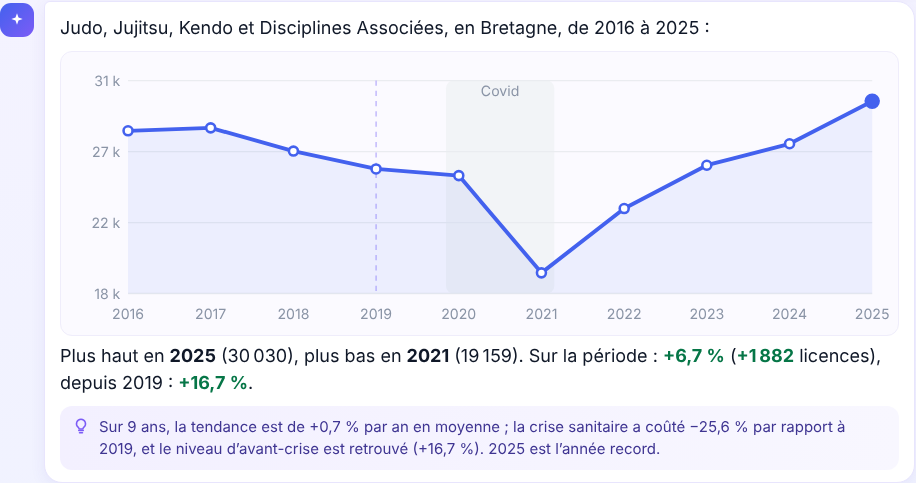
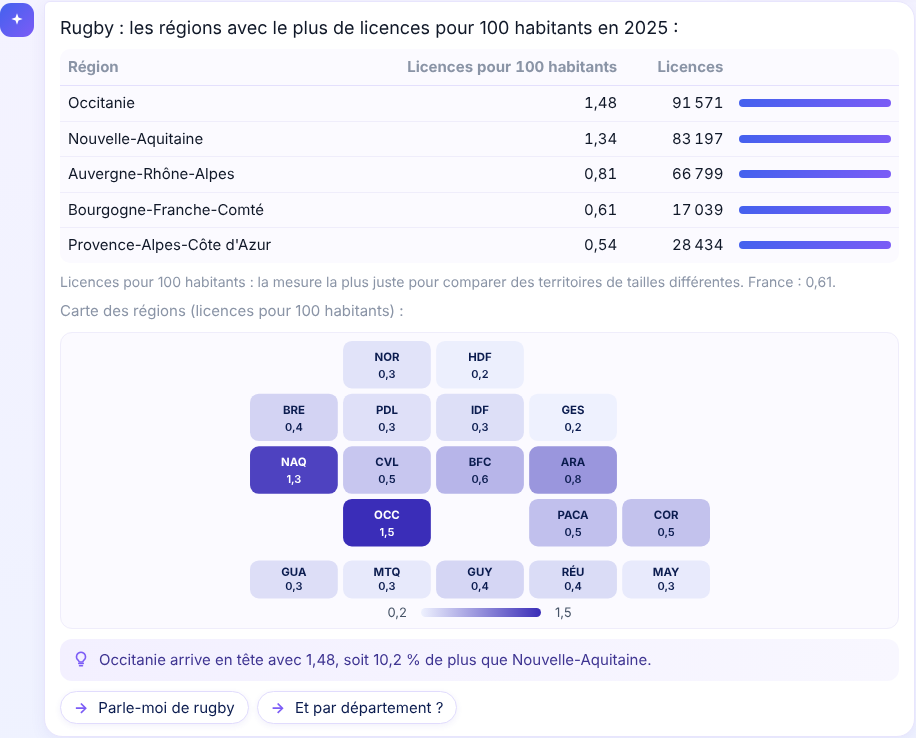
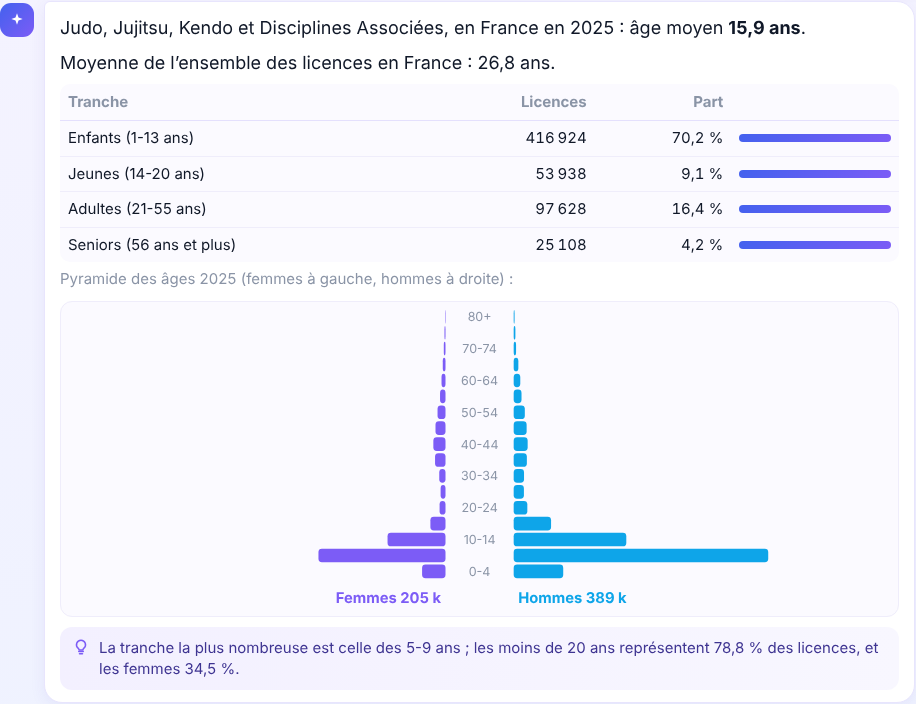
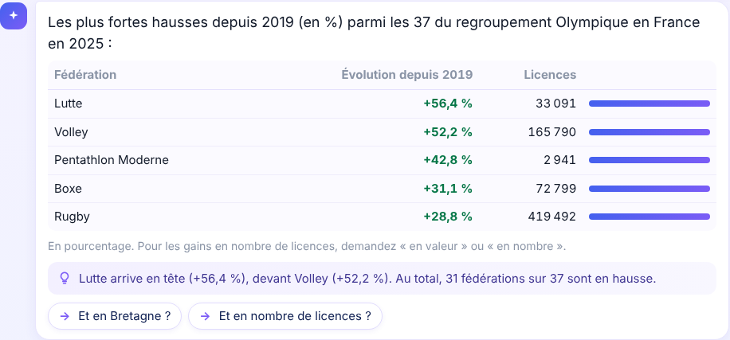
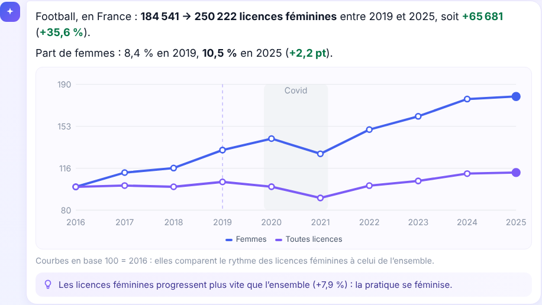
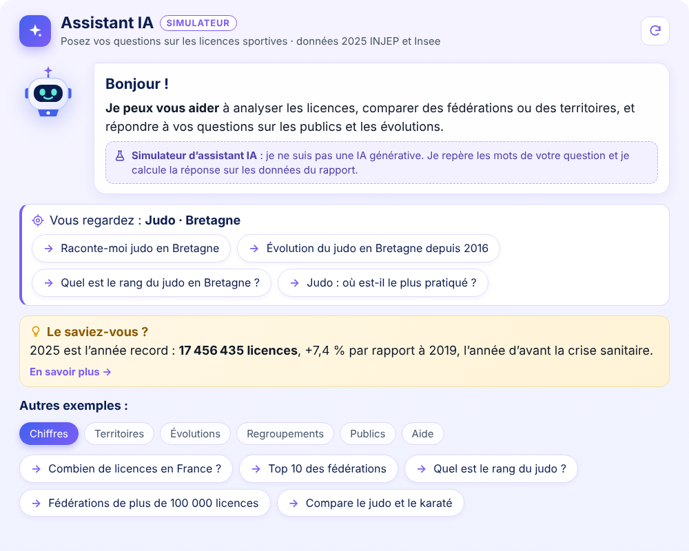
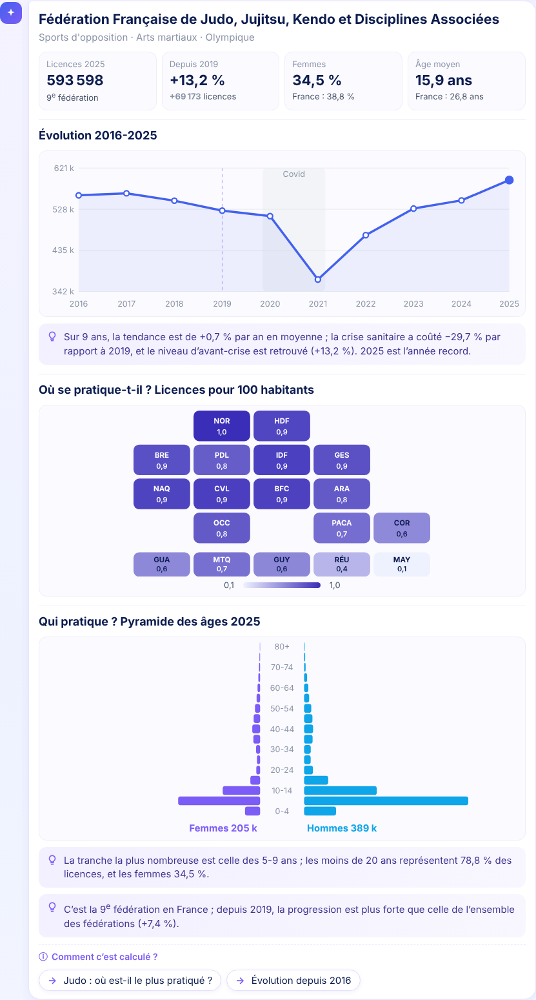

# 07 · Assistant intégré (simulateur d'IA)

Un panneau de discussion qui répond en français aux questions sur les licences : volumes, évolutions, territoires, regroupements, publics, définitions et usage du rapport.

Ce n'est **pas une IA générative**. Un moteur JavaScript reconnaît les éléments de la question et calcule la réponse sur les données mêmes du rapport. Il n'y a aucun appel réseau ni clé d'API : l'assistant fonctionne en **publication sur le web**. L'interface l'annonce clairement : badge « Simulateur », encadré d'accueil, mention sous la zone de saisie.

| | |
|---|---|
| **Questions de test** | 214 questions (6 fichiers), 0 erreur |
| **Contrôle des chiffres** | 39 valeurs comparées aux mesures DAX du rapport, toutes identiques (08/11/2026) |
| **Volume embarqué** | Environ 430 000 caractères de données en une trentaine de blocs, et environ 90 000 caractères de code en 4 blocs JS |
| **Réponse** | Moins de 50 ms : le modèle est construit une seule fois à l'ouverture |

---

## 1. Principe

| Couche | Rôle |
|---|---|
| `T_Assistant_Bloc` (table calculée) | Données précalculées à chaque actualisation, sans filtre. Une ligne par bloc de moins de 32 767 caractères. |
| Mesures du dossier `10. Assistant` | Renvoient un bloc par ligne : données (`<script type='text/plain' class='as-d'>`), interface, textes, moteur JS en 4 parties. |
| Visuel **HTML Content** (édition standard) | Champ Content : `T_Assistant_Bloc[Ordre]` puis `HTML Assistant`. Les blocs sont placés dans le même document. |
| Moteur JS | Lit les blocs, construit le modèle, analyse la question, calcule avec les règles des mesures, dessine les graphiques. |

### Pourquoi des blocs ?

Une valeur texte affichée dans un visuel est limitée à **32 767 caractères** (erreur « chaîne plus grande que le format de page »). Une colonne dans Content crée une ligne par valeur, et HTML Content place toutes les lignes dans **le même document**. Les tests ont montré trois choses :

- les scripts de toutes les lignes s'exécutent ;
- les lignes communiquent **par `document`** (`document.__as`), car les variables `window` ne passent pas d'une ligne à l'autre ;
- l'ordre d'affichage des lignes n'est pas garanti : chaque partie signale qu'elle est prête (`AS.pret.p1` à `p4`) et le moteur attend tous les blocs de données (`data-nb`) avant de démarrer.

## 2. Données embarquées (`T_Assistant_Bloc`)

| Type | Ordre | Contenu |
|---|---|---|
| `meta` | 0 | Année N, année de référence (2019), première année, date de mise à jour |
| `fed`, `ter` | 1, 2 | Fédérations (nom court, famille, sous-famille, groupe, libellé officiel) et territoires (région, zone, populations N, N-1, 2019) |
| `ser`, `sert` | 3, 4 | Séries 2016-N : par fédération (France) et par territoire (toutes fédérations) |
| `pro`, `prot` | 5, 6 | Âge moyen et grandes tranches d'âge N |
| `serf`, `sertf` | 7, 8 | Séries 2016-N des **licences féminines** |
| `pyr`, `pyrt` | 9, 10 | **Pyramides des âges** N : 17 tranches de 5 ans, femmes puis hommes |
| `sertr`, `serttr` | 11, 12 | Séries 2016-N par **grande tranche d'âge** (enfants, jeunes, adultes, seniors) |
| `cube` | 20 et suivants | Cube complet fédération × département : licences N, N-1, 2019 et femmes N |
| `serr` | 40 et suivants | Séries 2016-N **fédération × région** |
| `ui`, `txt`, `js` | 90 à 98 | Lignes vides, remplies par les mesures (interface, textes, moteur) |

## 3. Code (mesures du dossier `10. Assistant`)

| Mesure | Source | Rôle |
|---|---|---|
| `HTML Assistant` | — | Aiguillage : selon l'ordre de la ligne, renvoie un bloc de données ou une des mesures ci-dessous |
| `HTML Assistant UI` | — | Variables `--as-*` tirées de la charte (dossier 00), balise `div#as` avec la **sélection en cours** du rapport |
| `HTML Assistant CSS` | `assistant.css` | Styles du panneau (version modernisée, texte agrandi) |
| `HTML Assistant Textes` | `assistant-textes.txt` | Définitions, méthode, usage du rapport |
| `HTML Assistant JS 1` | `assistant-1-moteur.js` | Lecture des blocs, modèle, calculs, dictionnaire des noms, analyse de la question, indicateurs |
| `HTML Assistant JS 2` | `assistant-2-reponses.js` | Aiguillage des questions et réponses : valeurs, classements, comparaisons, séries, fiches |
| `HTML Assistant JS 3` | `assistant-3-graphiques.js` | Mini-graphiques SVG, phrases d'analyse, écran d'accueil et panneau de discussion |
| `HTML Assistant JS 4` | `assistant-4-questions.js` | Questions avancées : listes, rangs, deux années, seuils, critères combinés, tranches d'âge, homonymes, questions proches |

## 4. Calculs (alignés sur les mesures)

| Indicateur | Règle | Mesure de référence |
|---|---|---|
| Licences | Somme du cube, ou des séries pour une autre année | `NB Licences` |
| Évolution sur 1 an, depuis 2019 | En % (N / N-1 − 1) ou **en nombre de licences** (N − N-1), **à champ constant** : pour un regroupement ou un territoire, seules les fédérations présentes chaque année comptent (bloc `serhc` : licences hors champ par département) | `Évol 1 an`, `Évol depuis 2019`, `Licences champ constant` |
| Part de femmes, nombre de femmes | Licences F / toutes licences (non répartis compris) | `Part femmes`, `Licences femmes` |
| Évolution des licences féminines | En %, en nombre, ou évolution de la part en points | `Licences femmes` (2019 et N) |
| Licences pour 1 000 habitants | Seuls les départements ayant une population Insee entrent au numérateur | `Licences pour 1 000 hab` |
| Part, indice de spécificité | Part dans le territoire / part en France | `Part dans l'ensemble`, `Indice de spécificité` |
| Âge moyen, tranches, pyramide | Pondéré par les licences, âges non renseignés exclus | `Âge moyen` |

Les régions, zones (Métropole, DROM, COM, outre-mer) et regroupements sont recalculés en additionnant départements et fédérations.

### Contrôle automatique

`node test/controle_dax.js requete` écrit une requête DAX de 39 cas : fédérations, regroupements, régions, départements, années anciennes, femmes. On l'exécute dans Power BI (DAX Studio ou MCP), puis `node test/controle_dax.js comparer resultat.json` compare chaque valeur à celle de l'assistant.

Dernier contrôle : **39 identiques**. L'âge moyen par territoire diffère de moins de 0,05 an, à cause de l'arrondi des âges départementaux.

### Disponibilité des croisements

| Croisement | Années | Femmes | Âge |
|---|---|---|---|
| Fédération ou regroupement × France | 2016-N | Série complète | Âge moyen, tranches, pyramide, séries par tranche |
| Fédération × région, zone | 2016-N | N | — |
| Fédération × département | 2019, N-1, N | N | — |
| Toutes fédérations × territoire | 2016-N | Série complète | Âge moyen, tranches, pyramide, séries par tranche |

Les réponses portent toujours sur l'ensemble des licences : les segments Sexe et Âge du rapport ne s'appliquent pas.

## 5. Ce que l'assistant comprend

- **Sujets** : 120 fédérations (nom, libellé officiel, morceaux du nom, sigles, surnoms : foot, ping-pong, rando, UNSS…), familles, sous-familles et groupes.
- **Lieux** : France, Métropole, DROM, COM, outre-mer, 18 régions (et anciens noms : Alsace, Picardie, PACA…), départements par nom ou par code (« le 31 », « 2A »), gentilés (« les Bretons », « les Parisiens »).
- **Indicateurs** : licences, évolutions (en % ou en nombre), femmes (nombre, part, évolution), âge, tranches d'âge, pour 1 000 habitants, part, indice de spécificité, population.

| Type de question | Exemples |
|---|---|
| Valeur | « Combien de licences de judo en Occitanie ? », « Combien de seniors au golf ? » |
| Une autre année, deux années | « Football en Occitanie en 2017 », « Évolution du judo entre 2022 et 2024 » |
| Série et graphique | « Évolution du judo en Bretagne depuis 2016 », « Évolution des licences féminines au football » |
| Classement | « Top 10 des fédérations », « Qui gagne le plus de licences depuis 2019 en valeur ? », « Quel sport pour les enfants ? » |
| Classement dans un regroupement | « Quelle fédération olympique progresse le plus ? », « Quels sports collectifs gagnent le plus de licences ? » |
| Classement de regroupements | « Quelle sous-famille progresse le plus ? », « Classement des familles » |
| Classement de territoires | « Où le rugby est-il le plus pratiqué ? », « Quelle région a le plus de seniors ? » |
| Classement entre deux années | « Quelles fédérations progressent le plus entre 2021 et 2025 ? » |
| Rang | « Quel est le rang du judo ? », « La Bretagne est combien-ième ? » |
| Liste | « Liste des fédérations olympiques », « Liste des familles », « À quelle famille appartient le judo ? », « Départements de Bretagne » |
| Seuils et comptages | « Fédérations de plus de 100 000 licences », « Combien de fédérations progressent depuis 2019 ? » |
| Critères combinés | « Les sports les plus féminins qui progressent », « Les sports collectifs en baisse en Bretagne » |
| Comparaison | « Compare le judo et le karaté », « Bretagne et Normandie » |
| Fiche | « Parle-moi du tennis », « Parle-moi de la Bretagne » |
| Oui / non | « Le tennis a-t-il retrouvé son niveau d'avant Covid ? » |
| Définitions, méthode, usage | « C'est quoi l'indice de spécificité ? », « Pourquoi comparer à 2019 ? » |

- **Conversation** :
  - relances : « et en Bretagne ? », « et en nombre ? », « et en % ? », « et par département ? » ;
  - fautes de frappe, corrigées par distance d'édition ;
  - homonymes : « boxe » propose Boxe, Savate ou Boxe américaine ;
  - question non comprise : 3 questions proches sont proposées ;
  - pratiques sans fédération propre : padel, yoga, fitness…
- **Contexte** : si une fédération ou un territoire est choisi dans les segments, une question sans sujet ni lieu porte sur cette sélection.

## 6. Réponses enrichies

- **Mini-graphiques SVG**, sans bibliothèque :
  - courbe des années, avec la bande Covid et un repère sur 2019 ;
  - carte de France en tuiles (13 régions et 5 DROM), avec une échelle séquentielle, ou divergente pour les évolutions ;
  - pyramide des âges, femmes et hommes par tranches de 5 ans.
- **Phrase d'analyse automatique** : tendance annuelle moyenne, effet du Covid et reprise, rang et écart avec le suivant, nombre de fédérations en hausse, comparaison à l'ensemble, part d'une tranche d'âge.
- **Tableaux** avec barres, valeurs colorées (hausse en vert, baisse en rouge) et notes de méthode (seuils, unités).

| | |
|---|---|
|  |  |
|  |  |

### Version 4 : accueil, méthode et fiches

- **Accueil lié à la sélection du rapport** : si une fédération, un regroupement ou un territoire est sélectionné, l'accueil affiche « Vous regardez : Judo · Bretagne » et quatre questions adaptées (fiche, évolution, rang, lieux de pratique).
- **« Le saviez-vous ? »** : à chaque ouverture, un fait tiré au hasard dans les données (plus forte progression, plus fort gain, région la plus licenciée par habitant, sport le plus spécifique d'une région, fédération la plus féminine, public le plus jeune, année record, fédérations qui ont doublé), avec un bouton « En savoir plus » qui pose la question liée.
- **« Comment c'est calculé ? »** : sous chaque réponse chiffrée, un volet dépliable donne la formule de l'indicateur, la source (INJEP-MEDES, Insee) et les limites (non-répartis, licences ≠ personnes, années semi-définitives).
- **Fiches complètes « Raconte-moi… »** :
  - fédération ou regroupement : bandeau d'indicateurs (licences et rang, évolution depuis 2019, part de femmes, âge moyen), courbe, carte des licences pour 1 000 habitants, pyramide des âges, analyse ;
  - territoire : indicateurs, courbe, 5 premières fédérations, sports spécifiques, pyramide ;
  - fédération × territoire (« Raconte-moi le judo en Bretagne ») : indicateurs comparés à la France, courbe, tableau par département ;
  - « Raconte-moi » seul reprend la sélection du rapport.

| | |
|---|---|
|  |  |

## 7. Modifier l'assistant

Sources et outils : [`src/html/assistant/`](../src/html/assistant/), voir son `LISEZMOI.md`.

1. Modifier `src/assistant-*.js`, `src/assistant.css` ou `src/assistant-textes.txt`. Ne pas utiliser de guillemets doubles, ni de `|` ou `~` dans les textes.
2. Tester sur les vraies données (`test/blocs_reels.json`) : `node test/run.js`, puis `Q=questions2.txt` à `Q=questions7.txt`, puis `python test/ui.py` pour le rendu.
3. Construire : `npm i terser@5` (une fois), puis `node build.js` (taille de chaque bloc < 30 000, aucun guillemet double) et `node dax.js` (DAX des mesures et empreintes).
4. Coller les expressions dans les mesures. On peut aussi modifier les fichiers TMDL, Desktop fermé.
5. Contrôler les chiffres (`test/controle_dax.js`), puis faire Ctrl+S.

**Pièges rencontrés** :
- Le minifieur peut écrire des caractères invisibles (accents combinants, espace insécable) qui ne survivent pas au collage : le moteur les produit donc par code.
- Le « s » final est retiré à l'analyse (« plus » devient « plu »). Les motifs de recherche passent par la même normalisation.
- Une partie du moteur avait été perdue faute de source enregistrée. Elle a été retrouvée en comparant le code minifié en place avec le source. Depuis, les sources de `src/html/assistant/` font foi : `node build.js` reproduit exactement les mesures installées.

## 8. Pistes

- Panneau flottant : bouton « Assistant » dans le panneau gauche, affiché par signet sur les trois pages.
- Textes rédigés par fédération (clés `fiche:<code>`), ajoutés automatiquement en tête de fiche.
- Tranches d'âge et licences féminines par fédération et par région (aujourd'hui au niveau France seulement).
- Copier une réponse et exporter un tableau en CSV.
